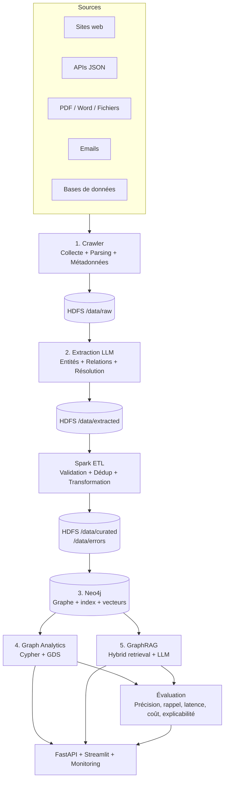
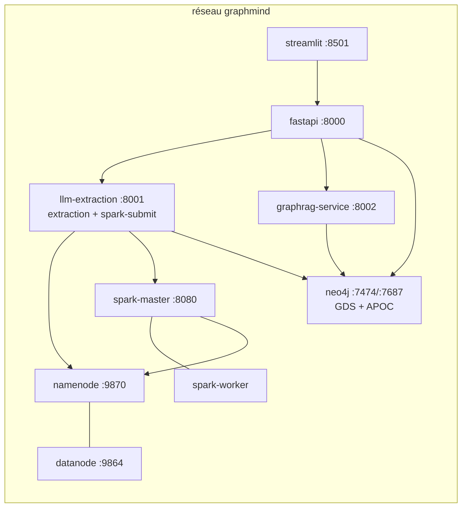
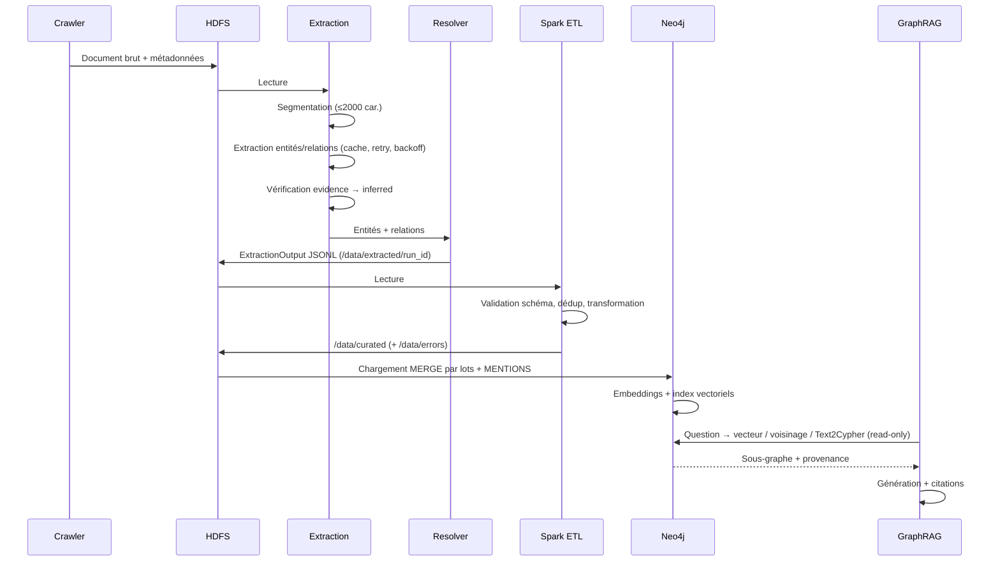

# Document de conception — Plateforme d'analytique sur graphe de connaissances alimentée par IA

## Vue d'ensemble

La plateforme collecte des documents hétérogènes, en extrait entités et relations avec un LLM, construit **un seul graphe Neo4j** et compare deux approches d'analyse sur ce même graphe :

- **Graph Analytics** : Cypher et algorithmes GDS (résultats structurés, déterministes).
- **GraphRAG** : récupération hybride (vectorielle + voisinage + Text2Cypher) puis génération LLM avec citations.

Domaine du corpus : écosystème d'innovation (universités, entreprises, chercheurs, projets, technologies, événements), entièrement synthétique.

### Décisions techniques

| Décision | Choix | Justification |
|---|---|---|
| Stockage brut et intermédiaire | HDFS (Docker) | Compatibilité Spark, traçabilité |
| Traitement batch | PySpark | Validation et déduplication distribuées |
| Graphe | Neo4j 5 + GDS + APOC | Cypher, algorithmes, index vectoriels natifs |
| Extraction | `LLMClient` abstrait (OpenAI, Anthropic, Ollama, Mock) | Comparer des modèles, tester sans API |
| Validation | Pydantic v2 | Sérialisation JSON réversible |
| Identifiants | `sha256(type:libellé_normalisé)[:16]` | Rejeu idempotent, pas de doublons |
| Résolution d'entités | rapidfuzz, par type | Évite les fusions absurdes entre types |
| Embeddings | sentence-transformers multilingue (réel), hash déterministe (mock) | Recherche sémantique reproductible en test |
| Cache d'extraction | Clé (hash passage, modèle, version prompt) | Rejeu sans coût LLM, expériences reproductibles |
| API / UI | FastAPI / Streamlit | Rapidité de développement |
| Réseau Docker | Un seul réseau `graphmind` | Simplifie Spark ↔ HDFS ↔ Neo4j |

---

## Architecture

### Flux global



### Topologie Docker Compose



Le service `llm-extraction` exécute l'extraction et lance le job Spark (`spark-submit`) ; le chargement Neo4j est fait côté driver Python à partir de `/data/curated/`.

### Séquence du pipeline



---

## Composants et interfaces

### 3.1 Configuration (`.env.example`)

```dotenv
# LLM
LLM_PROVIDER=openai            # openai | anthropic | ollama
LLM_MODEL=gpt-4o-mini
LLM_API_KEY=changeme
LLM_BASE_URL=                  # ex. http://ollama:11434 pour Ollama
MOCK_LLM=true
MOCK_CRAWLER=true
MOCK_EMBEDDINGS=true
PROMPT_VERSION=1

# Embeddings
EMBEDDING_MODEL=paraphrase-multilingual-MiniLM-L12-v2
EMBEDDING_DIM=384

# Résolution d'entités
ENABLE_ENTITY_RESOLUTION=true
SIMILARITY_THRESHOLD=0.85

# Infrastructure
NEO4J_URI=bolt://neo4j:7687
NEO4J_USER=neo4j
NEO4J_PASSWORD=changeme
HDFS_NAMENODE_URL=http://namenode:9870
SPARK_MASTER_URL=spark://spark-master:7077

# GraphRAG
RETRIEVAL_MODE=hybrid          # vector | neighborhood | text2cypher | hybrid
MAX_CONTEXT_NODES=50
NEIGHBORHOOD_DEPTH=2

# Crawler
ALLOWED_SOURCES=               # liste d'autorisation, séparée par des virgules
CRAWL_RATE_LIMIT_PER_SEC=1

# Auth
JWT_SECRET=changeme
JWT_EXPIRE_MINUTES=60
ADMIN_USERNAME=admin
ADMIN_PASSWORD=changeme

# Évaluation
JUDGE_ENABLED=false
LLM_PRICE_IN_PER_1K=0.0
LLM_PRICE_OUT_PER_1K=0.0
```

### 3.2 Graph_Schema (`config/graph_schema.yaml`)

```yaml
version: "1.0.0"

node_types:
  Person:       { required: [id, label, type], optional: [description, role] }
  Organization: { required: [id, label, type], optional: [description, sector, founded] }
  Location:     { required: [id, label, type], optional: [country, description] }
  Project:      { required: [id, label, type], optional: [description, start_date, end_date] }
  Technology:   { required: [id, label, type], optional: [description, domain] }
  Event:        { required: [id, label, type], optional: [description, start_date, end_date] }
  Document:     { required: [id, label, type, source, collected_at, content_hash], optional: [document_type, license] }

relation_types:
  WORKS_FOR:         { source: [Person],                         target: [Organization],           properties: [role, since] }
  COLLABORATES_WITH: { source: [Organization],                   target: [Organization],           properties: [since] }
  LOCATED_IN:        { source: [Person, Organization, Event],    target: [Location],               properties: [] }
  LEADS:             { source: [Person],                         target: [Project],                properties: [] }
  PARTICIPATES_IN:   { source: [Person, Organization],           target: [Project, Event],         properties: [role] }
  FUNDS:             { source: [Organization],                   target: [Project],                properties: [amount_range] }
  USES:              { source: [Project],                        target: [Technology],             properties: [] }
  ORGANIZES:         { source: [Organization],                   target: [Event],                  properties: [] }
  MENTIONS:          { source: [Document], target: [Person, Organization, Location, Project, Technology, Event],
                       properties: [passage_id, char_offset, confidence_score] }

common_properties:
  confidence_score: { type: float, range: [0.0, 1.0] }
  inferred:         { type: bool }
```

```python
# src/shared/graph_schema.py
@dataclass
class NodeTypeSpec:
    name: str
    required_props: list[str]
    optional_props: list[str]

@dataclass
class RelationTypeSpec:
    name: str
    source_types: list[str]
    target_types: list[str]
    properties: list[str]

class GraphSchema:
    version: str
    node_types: dict[str, NodeTypeSpec]
    relation_types: dict[str, RelationTypeSpec]

    @classmethod
    def load(cls, path: str) -> "GraphSchema": ...
    def validate_node(self, node: dict) -> bool: ...
    def validate_relation(self, relation: dict, src_type: str, tgt_type: str) -> bool: ...
    def is_compatible(self, other: "GraphSchema") -> bool: ...
    def assert_node_type(self, name: str) -> str: ...      # liste blanche
    def assert_relation_type(self, name: str) -> str: ...  # liste blanche
```

### 3.3 Normalisation et identifiants (`src/shared/ids.py`)

```python
import hashlib, re, unicodedata

def normalize_label(label: str) -> str:
    s = unicodedata.normalize("NFKD", label)
    s = "".join(c for c in s if not unicodedata.combining(c))
    s = re.sub(r"[^\w\s]", " ", s.lower())
    return re.sub(r"\s+", " ", s).strip()

def entity_id(entity_type: str, label: str) -> str:
    return hashlib.sha256(f"{entity_type}:{normalize_label(label)}".encode()).hexdigest()[:16]

def relation_id(rel_type: str, src_id: str, tgt_id: str) -> str:
    return hashlib.sha256(f"{rel_type}:{src_id}:{tgt_id}".encode()).hexdigest()[:16]
```

Un même libellé normalisé du même type produit toujours le même identifiant : rejouer le pipeline ne crée pas de doublons.

### 3.4 Crawler

```
src/crawler/
├── collector.py       # orchestration + CrawlerConfig
├── sources/           # web.py, api.py, filesystem.py, email.py, database.py
├── parsers/           # html, pdf, word, email, json, db_rows
├── hdfs_writer.py     # WebHDFS
└── mock_corpus/       # généré par scripts/generate_corpus.py (graine fixe)
```

```python
class DocumentMetadata(BaseModel):
    source: str
    collected_at: datetime          # ISO 8601
    document_type: str              # html | pdf | word | email | json | db
    content_hash: str               # SHA-256
    license: str | None = None

class ParsedDocument(BaseModel):
    metadata: DocumentMetadata
    text_content: str
    raw_path: str                   # /data/raw/{type}/{hash}

class CrawlerConfig(BaseModel):
    mock_mode: bool = False
    hdfs_base_path: str = "/data/raw"
    allowed_sources: list[str] = []
    rate_limit_per_sec: float = 1.0
    sources: list[dict] = []
```

Règles : respect de `robots.txt`, liste d'autorisation, écriture idempotente (hash déjà présent → ignoré), erreurs journalisées sans interrompre.

### 3.5 Client LLM

```python
# src/llm/client.py
class LLMResponse(BaseModel):
    text: str
    tokens_in: int
    tokens_out: int
    latency_ms: float

class LLMClient(ABC):
    @abstractmethod
    def extract_entities(self, passage: str) -> tuple[list[EntityResult], LLMResponse]: ...
    @abstractmethod
    def extract_relations(self, passage: str, entities: list[EntityResult]) -> tuple[list[RelationResult], LLMResponse]: ...
    @abstractmethod
    def generate_response(self, prompt: str) -> LLMResponse: ...

def create_llm_client() -> LLMClient: ...   # lit LLM_PROVIDER, LLM_MODEL, LLM_API_KEY, LLM_BASE_URL, MOCK_LLM
```

Implémentations : `OpenAIClient`, `AnthropicClient`, `OllamaClient` (HTTP, sans clé), `MockLLMClient` (sortie déterministe dérivée du hash du passage). Le prompt d'extraction injecte le Graph_Schema, exige du JSON et demande pour chaque relation un champ `evidence` (citation exacte du passage). Chaque appel journalise modèle, tokens et latence.

### 3.6 Service d'extraction

```
src/extraction/
├── models.py              # Provenance, EntityResult, RelationResult, ExtractionOutput
├── segmenter.py           # passages ≤ 2000 caractères
├── entity_extractor.py
├── relation_extractor.py
├── evidence_checker.py    # vérifie evidence ⊂ passage → inferred
├── cache.py               # clé (hash passage, modèle, PROMPT_VERSION)
└── service.py             # orchestration, retry, écriture HDFS
```

```python
class Provenance(BaseModel):
    source_doc: str          # content_hash du document
    passage_id: str
    char_offset: int

class EntityResult(BaseModel):
    id: str                                  # entity_id(type, label)
    label: str
    type: str                                # ∈ Graph_Schema.node_types
    aliases: list[str] = []
    properties: dict[str, object] = {}
    confidence_score: float = Field(ge=0.0, le=1.0)
    inferred: bool                           # False si le libellé figure littéralement dans le passage
    provenances: list[Provenance]

class RelationResult(BaseModel):
    id: str                                  # relation_id(...)
    relation_type: str
    source_entity_id: str
    target_entity_id: str
    properties: dict[str, object] = {}
    evidence: str = ""                       # vide si inferred
    confidence_score: float = Field(ge=0.0, le=1.0)
    inferred: bool                           # False ssi evidence non vide ET présente dans le passage
    provenances: list[Provenance]

class ExtractionOutput(BaseModel):
    document_id: str
    passage_id: str
    entities: list[EntityResult]
    relations: list[RelationResult]
```

**Vérification de l'evidence** : après normalisation, si `evidence` est une sous-chaîne du passage → `inferred=False` ; sinon `inferred=True` et `evidence=""`. Même logique pour les entités avec leur libellé.

**Retry** :

```python
MAX_RETRIES = 3
def extract_with_retry(passage, client, schema) -> ExtractionOutput | None:
    for attempt in range(MAX_RETRIES):
        try:
            return _extract(passage, client, schema, prompt_variant=attempt)
        except (ExtractionParseError, LLMCallError) as e:
            logger.warning("extraction_retry", attempt=attempt + 1, error=str(e))
            time.sleep(2 ** attempt)           # backoff exponentiel
    logger.error("extraction_failed", document_id=..., passage_id=...)
    return None
```

Le service écrit les sorties dans `/data/extracted/{run_id}/*.jsonl` avec un fichier `run_meta.json` (modèle, version du prompt, version du schéma, `ENABLE_ENTITY_RESOLUTION`).

### 3.7 Entity_Resolver

```python
class EntityResolver:
    def __init__(self, threshold: float = 0.85, enabled: bool = True): ...
    def find_duplicates(self, entities) -> list[tuple[EntityResult, EntityResult]]:
        """Regroupe par type ; compare uniquement au sein d'un type (rapidfuzz)."""
    def merge(self, canonical, duplicate) -> EntityResult:
        """Union des provenances et des alias, score max,
           inferred = canonical.inferred AND duplicate.inferred."""
    def resolve(self, entities, relations) -> tuple[list[EntityResult], list[RelationResult]]:
        """Fusion + réécriture des source/target_entity_id des relations."""
```

Si `enabled=False`, seule la normalisation d'identifiant s'applique (pas de fusion floue). Chaque fusion est journalisée. Aucune relation ne doit pointer vers un identifiant absent de la liste canonique.

### 3.8 Spark ETL

```
src/etl/
├── spark_session.py   # SPARK_MASTER_URL ou local[*]
├── validator.py       # validation Graph_Schema, isolation des erreurs
├── deduplicator.py    # groupBy(id) : collect provenances, max(confidence), AND inferred
├── transformer.py     # format nœuds/relations Neo4j
└── job.py             # point d'entrée spark-submit
```

Entrée : `/data/extracted/{run_id}/`. Sorties : `/data/curated/{run_id}/nodes.jsonl`, `relations.jsonl`, `mentions.jsonl`, et `/data/errors/{run_id}/` pour les éléments invalides (`document_id`, `entity_id`, `violation`, `raw_data`, `timestamp`).

### 3.9 Chargement Neo4j

```python
# src/etl/neo4j_loader.py  (labels et types validés par liste blanche avant formatage)
MERGE_NODES = """
UNWIND $rows AS row
MERGE (n:`{label}` {{id: row.id}})
ON CREATE SET n += row.props, n.created_at = datetime()
ON MATCH  SET n += row.props, n.updated_at = datetime(),
              n.confidence_score = CASE WHEN row.props.confidence_score > n.confidence_score
                                        THEN row.props.confidence_score ELSE n.confidence_score END,
              n.inferred = (n.inferred AND row.props.inferred)
"""

MERGE_RELATIONS = """
UNWIND $rows AS row
MATCH (src:`{src_label}` {{id: row.src_id}})
MATCH (tgt:`{tgt_label}` {{id: row.tgt_id}})
MERGE (src)-[r:`{rel_type}` {{id: row.id}}]->(tgt)
ON CREATE SET r.confidence_score = row.confidence_score,
              r.inferred = row.inferred,
              r.evidence = row.evidence,
              r.source_docs = row.source_docs
ON MATCH SET  r.confidence_score = CASE WHEN row.confidence_score > r.confidence_score
                                         THEN row.confidence_score ELSE r.confidence_score END,
              r.inferred = (r.inferred AND row.inferred),
              r.evidence = apoc.coll.toSet(r.evidence + row.evidence),
              r.source_docs = apoc.coll.toSet(r.source_docs + row.source_docs)
"""

CREATE_MENTIONS = """
UNWIND $rows AS row
MATCH (d:Document {id: row.doc_id})
MATCH (e {id: row.entity_id})
MERGE (d)-[m:MENTIONS {passage_id: row.passage_id}]->(e)
ON CREATE SET m.char_offset = row.char_offset, m.confidence_score = row.confidence_score
"""
```

Les nœuds `Document` sont créés à partir des métadonnées du Crawler (`id` = `content_hash`). Les contraintes d'unicité (`id`) et les index (`label`, `type`) sont créés par `scripts/init_neo4j.cypher`. `reset_graph()` vide le graphe pour les expériences.

> Remarque : `evidence` est stocké en liste de chaînes sur la relation ; en `ON CREATE`, `row.evidence` doit être fourni sous forme de liste. La provenance détaillée d'une relation passe par `source_docs` et par les relations `MENTIONS` des entités extrémités.

### 3.10 Embeddings et index vectoriels

```
src/embeddings/
├── embedder.py        # Embedder (abstrait), SentenceTransformerEmbedder, MockEmbedder
├── node_embedder.py   # calcule et stocke n.embedding
└── vector_index.py    # un index par type de nœud
```

```cypher
CREATE VECTOR INDEX person_embedding IF NOT EXISTS
FOR (n:Person) ON (n.embedding)
OPTIONS {indexConfig: {`vector.dimensions`: $dim, `vector.similarity_function`: 'cosine'}};

CALL db.index.vector.queryNodes($index_name, $k, $query_vector)
YIELD node, score
```

`MockEmbedder` : vecteur déterministe dérivé d'un hash (normalisé). Texte embeddé = libellé + alias + description. Changer de modèle ou de dimension impose de recréer les index et de recalculer les embeddings.

### 3.11 Graph_Analytics_Module

```python
class GraphAnalyticsModule:
    def __init__(self, driver, schema): ...

    # Cypher
    def get_neighborhood(self, node_id: str, depth: int = 1) -> dict: ...
    def find_paths(self, from_id: str, to_id: str, max_depth: int = 5) -> list[dict]: ...
    def multi_hop_query(self, start_id: str, hops: int, relation_types: list[str] | None = None) -> list[dict]: ...
    def aggregate(self, query: str, params: dict) -> list[dict]: ...
    def run_reference_query(self, cypher_query: str) -> list[dict]: ...   # pour le benchmark

    # GDS
    def _get_or_create_projection(self, name: str, rel_weight_property: str = "confidence_score") -> str: ...
    def run_pagerank(self) -> list[dict]: ...
    def run_community_detection(self, algorithm: str = "louvain") -> list[dict]: ...
    def run_centrality(self, algorithm: str = "betweenness") -> list[dict]: ...
    def run_shortest_path(self, from_id: str, to_id: str) -> dict: ...   # coût = 1 - confidence_score
    def run_similarity(self, algorithm: str = "nodeSimilarity") -> list[dict]: ...
```

Tous les résultats incluent `confidence_score`, `inferred`, les documents sources et, pour les algorithmes (similarité, communautés), le marqueur `computed=True`.

### 3.12 GraphRAG_Service

```
src/graphrag/
├── entity_linker.py      # libellé, alias, similarité vectorielle
├── retriever.py          # vector | neighborhood | text2cypher | hybrid
├── cypher_guard.py       # validation read-only des requêtes générées
├── context_builder.py
├── response_generator.py
├── models.py
└── service.py
```

**Garde Text2Cypher** :

```python
FORBIDDEN = re.compile(
    r"\b(CREATE|MERGE|SET|DELETE|DETACH|REMOVE|DROP|FOREACH|LOAD\s+CSV)\b", re.IGNORECASE)
ALLOWED_CALLS = {"db.index.vector.queryNodes"}

def validate_read_only(cypher: str) -> str:
    if FORBIDDEN.search(cypher):
        raise GraphRAGError("Clause d'écriture interdite")
    for proc in re.findall(r"CALL\s+([\w\.]+)", cypher, flags=re.IGNORECASE):
        if proc not in ALLOWED_CALLS:
            raise GraphRAGError(f"Procédure non autorisée : {proc}")
    return cypher

# exécution : session.execute_read(...), jamais execute_write
```

**Récupération hybride** : entity linking → (a) recherche vectorielle top-k par type, (b) expansion du voisinage des entités liées, (c) requête Text2Cypher validée ; fusion des résultats, dédoublonnage, limitation à `MAX_CONTEXT_NODES`, collecte de la provenance.

```python
class Citation(BaseModel):
    source_doc: str
    passage_id: str
    node_id: str | None = None
    is_inferred: bool
    confidence_score: float

class GraphRAGResponse(BaseModel):
    question: str
    answer: str
    citations: list[Citation]
    retrieval_mode: str
    retrieval_query: str
    context_nodes_count: int
    context_relations_count: int
    tokens_in: int
    tokens_out: int
    total_latency_ms: float
    is_partial: bool = False
```

Le prompt impose de répondre uniquement avec le contexte et de signaler les éléments inférés ; contexte vide → réponse partielle (`is_partial=True`), jamais d'invention.

### 3.13 Evaluator

```python
class GroundTruthQuestion(BaseModel):
    id: str
    text: str
    type: Literal["multi_hop", "semantic", "neighborhood", "aggregation"]
    expected_entities: list[str]
    expected_answer_contains: list[str]
    cypher_query: str            # requête de référence (approche Graph Analytics)
    notes: str

class EvaluationResult(BaseModel):
    approach: Literal["graph_analytics", "graphrag"]
    question_id: str
    question_type: str
    precision: float
    recall: float
    latency_ms: float
    tokens_in: int
    tokens_out: int
    cost: float
    has_citations: bool
    citations_valid: bool
    inferred_correctly_marked: bool
    sources_traceable: bool
```

**Calcul** : précision = |retournées ∩ attendues| / |retournées| ; rappel = |retournées ∩ attendues| / |attendues|. Graph Analytics exécute `cypher_query` et récupère les libellés retournés. GraphRAG combine entités citées et entités du graphe reconnues dans la réponse ; un juge LLM (`JUDGE_ENABLED`) peut compléter. Le coût est calculé avec `LLM_PRICE_*`.

**Expériences** (`src/evaluation/experiments.py`) :

| Id | Contenu | Question de recherche |
|---|---|---|
| E1 | Extraction contre `extraction_gold.json` : précision, rappel, F1 par type | QR1 |
| E2 | Rejeu de l'ETL depuis `/data/extracted` avec résolution activée puis désactivée (`reset_graph()` entre les deux), comparaison doublons, orphelins, précision des réponses | QR2 |
| E3 | Graph Analytics vs GraphRAG par type de question, avec latence et coût | QR3, QR4 |
| E4 | Modes de récupération `vector`, `neighborhood`, `text2cypher`, `hybrid` | QR3, QR4 |
| Transversal | Mesure d'explicabilité (citations, marquage inféré, traçabilité) | QR5 |

Le rapport Markdown enregistre la configuration (modèles, versions, seuils, graine). Un benchmark exécuté avec `MOCK_LLM=true` est étiqueté « non significatif ».

### 3.14 API et authentification

| Méthode | Endpoint | Rôle |
|---|---|---|
| POST | `/ingest` | admin |
| POST | `/extract` | admin |
| GET | `/analytics/neighborhood/{node_id}` | user |
| GET | `/analytics/paths` | user |
| POST | `/analytics/gds/{algorithm}` | user |
| POST | `/graphrag/ask` | user |
| POST | `/evaluate` | admin |
| GET | `/schema` | user |
| GET | `/health` | public |
| POST | `/auth/login` | public |

JWT (claims : `sub`, `role`, `exp`), mots de passe bcrypt, `require_role(Role.admin)`. 401 si non authentifié, 403 si rôle insuffisant, 422 sur entrée invalide.

### 3.15 Interface Streamlit

Pages : **Graphe** (`pyvis` ou `streamlit-agraph`, provenance au survol, éléments inférés en couleur ou trait différent), **Questions** (réponse, citations, mode de récupération), **Analytics** (GDS et Cypher, résultats tabulaires avec marquage `inferred` / `computed`), **Évaluation** (lancement et affichage du rapport).

### 3.16 Monitoring

Logs JSON via `structlog` (`timestamp`, `level`, `component`, `event`, contexte). Métriques : `pipeline_documents_ingested_total`, `neo4j_nodes_total` (par type), `llm_call_latency_ms`, `llm_tokens_used_total`, `graphrag_query_latency_ms`. `/health` retourne l'état de Neo4j, HDFS, Spark et du LLM. Jamais de secret dans les logs.

---

## Modèle de données Neo4j

**Nœuds** : `id`, `label`, `type`, `confidence_score`, `inferred`, `embedding`, `created_at`, `updated_at`, propriétés propres au type. `Document` : `source`, `collected_at`, `content_hash`, `document_type`, `license`.

**Relations métier** : `id`, `confidence_score`, `inferred`, `evidence` (liste), `source_docs` (liste).

**`MENTIONS`** (`Document` → entité) : `passage_id`, `char_offset`, `confidence_score`. C'est le support de la traçabilité de chaque élément jusqu'au document source.

## Propriétés de correction

1. **Round-trip des entités** : pour toute `EntityResult` valide, `model_validate_json(model_dump_json(e)) == e`. *(Exigences 9.2)*
2. **Round-trip des relations** : idem pour `RelationResult`. *(Exigences 9.2)*
3. **Score borné** : tout `confidence_score` produit ou accepté est dans [0, 1] ; une valeur hors bornes est rejetée. *(Exigences 9.6)*
4. **Cohérence explicite/inféré** : pour toute relation extraite, `inferred=False` ⇔ `evidence` non vide et sous-chaîne (normalisée) du passage ; sinon `inferred=True` et `evidence=""`. *(Exigences 7.4, 8.4, 8.5)*
5. **Identifiants déterministes** : deux entités de même type et de même libellé normalisé ont le même identifiant ; deux types différents donnent des identifiants différents. *(Exigences 10.2)*
6. **Fusion préservant provenances et score** : pour deux entités du même type fusionnées, le résultat contient l'union des provenances et un score égal au maximum. *(Exigences 10.4, 10.8)*
7. **Intégrité des relations après résolution** : après `resolve`, toute relation référence un identifiant présent dans la liste d'entités canoniques. *(Exigences 10.5)*
8. **Conformité des nœuds au schéma** : tout nœud validé par le Spark_ETL possède un `id` et toutes les propriétés obligatoires de son type. *(Exigences 12.2, 13.1)*
9. **Déterminisme du mock** : `MockLLMClient` et `MockEmbedder` produisent des sorties identiques pour des entrées identiques. *(Exigences 6.5, 14.1)*
10. **Garde Text2Cypher** : toute requête contenant une clause d'écriture ou une procédure hors liste blanche est rejetée ; une requête de lecture simple est acceptée. *(Exigences 17.6)*
11. **Round-trip des réponses API** : pour toute `GraphRAGResponse`, la sérialisation puis la désérialisation produit un objet identique. *(Exigences 22.4)*
12. **Idempotence du chargement** *(test d'intégration)* : charger deux fois les mêmes données donne le même nombre de nœuds et de relations. *(Exigences 13.3)*

## Gestion des erreurs

```python
class PlatformError(Exception): ...
class CrawlerError(PlatformError): ...
class UnsupportedDocumentTypeError(CrawlerError): ...
class LLMConfigError(PlatformError): ...
class LLMCallError(PlatformError): ...         # réseau, délai, limite de débit
class ExtractionParseError(PlatformError): ... # sortie LLM non conforme (≠ pydantic.ValidationError)
class SchemaViolationError(PlatformError): ...
class EntityResolutionError(PlatformError): ...
class SparkETLError(PlatformError): ...
class Neo4jLoadError(PlatformError): ...
class GraphAnalyticsError(PlatformError): ...
class GraphRAGError(PlatformError): ...
class AuthError(PlatformError): ...
```

| Situation | Comportement |
|---|---|
| Source inaccessible | Log (URL, type d'erreur), on continue |
| Type non supporté / fichier corrompu | Log, document ignoré |
| Clé LLM manquante | `LLMConfigError` nommant la variable |
| Erreur réseau LLM | `LLMCallError`, retry avec backoff |
| Sortie LLM non conforme | `ExtractionParseError`, 3 essais avec prompt reformulé |
| Échec définitif d'extraction | Log (`document_id`, `passage_id`), passage ignoré |
| Violation du schéma | Isolation dans `/data/errors/` |
| Requête Text2Cypher interdite | `GraphRAGError`, requête non exécutée |
| Contexte GraphRAG insuffisant | Réponse partielle, `is_partial=True` |

## Stratégie de tests

Pytest, Hypothesis (≥100 exemples par propriété, pas de fixture à portée fonction dans `@given`), `testcontainers` pour Neo4j et HDFS, pipeline complet en mode mock sans réseau.

```
tests/
├── conftest.py
├── phase1_ingestion/      # crawler, parseurs, corpus, hash
├── phase2_extraction/     # propriétés 1-7 et 9, client LLM, évidence, retry
├── phase3_etl/            # validation, dédup, chargement (propriétés 8 et 12)
├── phase4_analytics/      # Cypher, GDS
├── phase5_graphrag/       # propriété 10, retrieval, citations, réponse partielle
├── phase6_evaluation/     # métriques, expériences, rapport, cohérence du Ground Truth
├── phase7_api/            # auth, endpoints, propriété 11
└── integration/           # pipeline de bout en bout en mode mock
```

Les cibles `make test-phase1` à `make test-phase7` et `make test-all` lancent chaque dossier ; `make benchmark` exécute les expériences E1 à E4 (avec un LLM réel pour des résultats significatifs).
